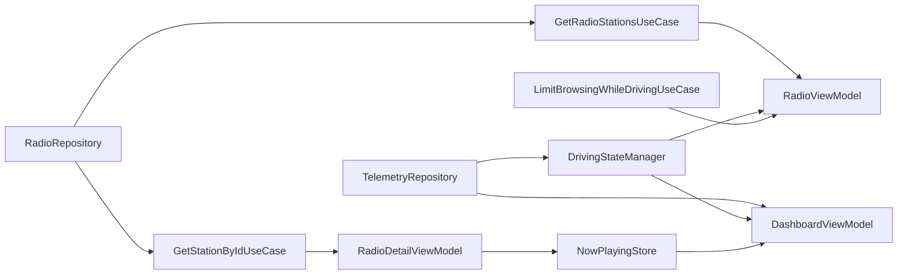

# AutoDroid

[](https://github.com/yurikayel/autodroid/actions/workflows/ci.yml)

A small Android Automotive OS (AAOS) proof of concept: a multi-brand **Calm Cockpit** with live vehicle telemetry, a voice companion, and a radio browser that respects driving restrictions.

Everything runs on a standard emulator. Vehicle data and the station directory are simulated behind repository interfaces so real platform sources can be swapped in without touching the UI or the domain rules.

## UI principles (Design for Driving + Material 3 Expressive)

| Rule | How AutoDroid applies it |
| --- | --- |
| Glanceable in ~2 s | Large speed numerals (Outfit + tabular figures), short labels, bento tiles |
| Touch targets ≥ 76 dp (car) / ≥ 56 dp (phone) | `LocalCarDimens`; station rows 96 dp wide / 72 dp compact |
| Spacing ≥ 23 dp (car) / 12 dp (phone) | `targetSpacing` from compact or wide tokens |
| Night = negative polarity | Every brand has full light **and** dark schemes; Harbor no longer light-only |
| Focus while moving | Secondary tiles collapse, motion switches to `MotionScheme.standard()`, ambient glow freezes, VoiceOrb pulse stops, radio list caps with a dimmed “more when parked” footer |
| Motion as feedback | `MaterialExpressiveTheme` + `MotionScheme.expressive()` when parked; shape-morphing `VoiceOrb` |
| Adaptive shell | `NavigationSuiteScaffold` (rail on wide / landscape, bar on phone); radio uses `ListDetailPaneScaffold` on wide screens |

Brand themes are fictional: **Northwind**, **Summit**, **Harbor**. Theme switching lives on the nav suite, not in the driver’s primary glance zone.

## What it shows

| Area | What to look at |
| --- | --- |
| Multi-brand theming | Three complete Material 3 color roles (containers, outline, surface tiers) × day/night |
| Drive screen | Canvas speed arc, energy ring, now-playing with 76 dp controls, driving status pill |
| UX restrictions | `DrivingStateManager` + `LimitBrowsingWhileDrivingUseCase`; UI mode change, not only hiding RPM |
| List / detail | Loading (`LoadingIndicator`), empty, error + Retry, detail ViewModel with assisted injection |
| Navigation | Type-safe routes; suite scaffold + list-detail on large width |
| Voice | Morphing orb by `VoiceState`; transcript capsule; SpeechRecognizer / TTS with simulation fallback |
| Demo control | Debug-only bottom sheet (Normal / Empty / Error) |

## Architecture

Layering by package inside a single `:app` module:

```
core/        automotive, designsystem, voice, demo, media
domain/      models, repository interfaces, use cases
data/        fake repositories
di/          Hilt modules, application CoroutineScope
feature/     dashboard (Drive), radio
```



### Simulated vs. real

| In this POC | On a real head unit |
| --- | --- |
| `FakeTelemetryRepository` | `CarPropertyManager` / VHAL for speed, fuel, gear, RPM |
| `DrivingStateManager` (speed > 5 km/h) | `CarUxRestrictionsManager` |
| Cap at 4 stations while moving | `getMaxCumulativeContentItems()` under `LIMIT_CONTENT` |
| `FakeRadioRepository` + `DemoScenarioStore` | Broadcast / station directory API with the same `Result` contract |

## Decisions and trade-offs

- **Single module, layered by package.** Next step: `:core:designsystem`, `:domain`, feature modules.
- **Toolchain:** AGP 9.1, Gradle 9.3.1, Kotlin 2.2.21 (built-in Kotlin opted out for Hilt/KSP stability), Compose BOM 2026.08.00 with **material3 1.5.0-alpha28** so `MaterialExpressiveTheme` / `MotionScheme` are public. `android.builtInKotlin=false` until AGP 10 removes the escape hatch.
- **Expressive APIs** are still alpha-flagged in places; opt-in is isolated in `core/designsystem` and feature UI.
- **Fakes over mocks** for domain/data; MockK kept for Android-bound voice APIs.
- **Assisted injection** for detail `stationId`.

## Tests

```
./gradlew testDebugUnitTest
```

Local JVM tests cover ViewModels, the driving-restriction use case, voice parsing, Drive focus-mode UI, radio empty/error/restricted rows (including ≥ 76 dp targets), and the gauge card.

## Build and run

- JDK **21** for Gradle (Robolectric + SDK 36 sandbox).
- `compileSdk 37`, `targetSdk 36`.

```
$env:JAVA_HOME = "C:\Program Files\Eclipse Adoptium\jdk-21.0.9.10-hotspot"
./gradlew clean assembleDebug testDebugUnitTest
```

Prefer an **Automotive AVD** in landscape for the Calm Cockpit layout. Debug builds also install on a phone emulator (debug manifest relaxes the automotive feature). Use the Theme item in the nav suite to cycle brands; tap or long-press the voice orb on Drive.

## Screenshots

Captured on `medium_phone` (`c:\project\autodroid-shots`):

| Shot | What it shows |
| --- | --- |
| `50-drive-parked-land.png` | Landscape Drive — media + orb anchored at bottom |
| `51-drive-moving-land.png` | Landscape focus mode — no dead zone under media |
| `52-phone-drive-moving.png` | Phone focus — brand headline hidden |
| `53-phone-radio-detail.png` | Phone station detail with Now playing chip |

## Next steps

- Real `CarPropertyManager` and `CarUxRestrictionsManager` adapters.
- Offline cache-first stations (Room).
- Cold start: baseline profile + `reportFullyDrawn` on an Automotive AVD (release).
- Voice → vehicle controls with confirmation while moving.
